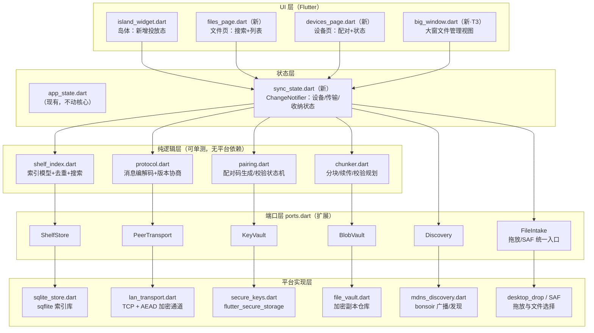
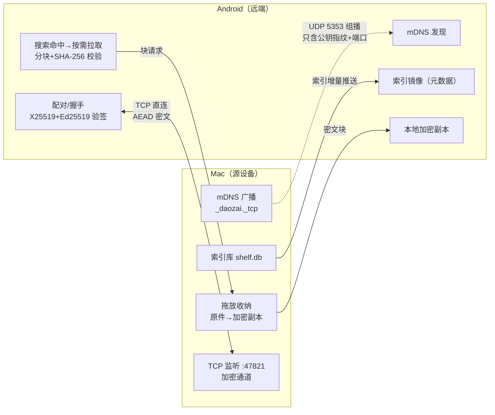
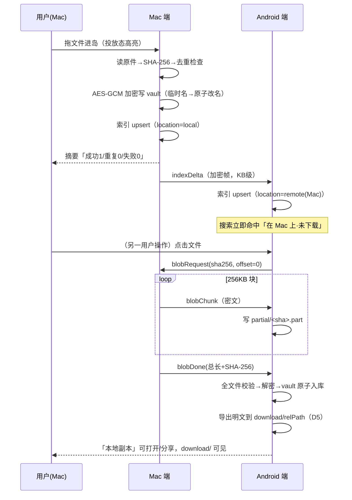
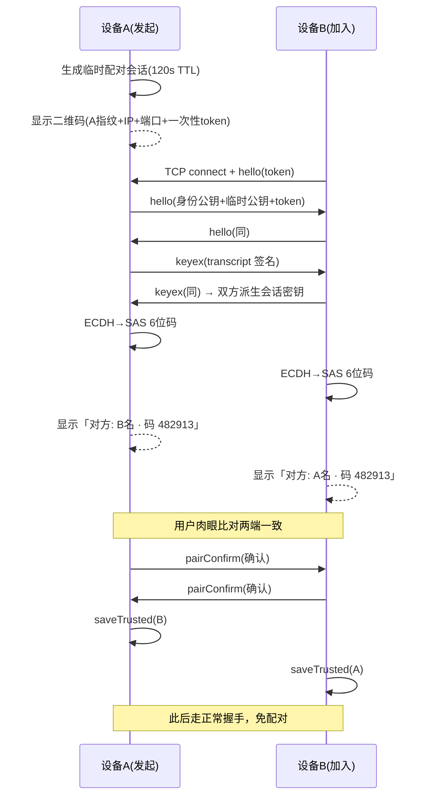

# 设计文档：跨端文件置物架（无服务器 · 端到端加密）

- Spec：`windows-macosmac` · 阶段：Design
- 依据：`requirements.md`（D1=A 仅局域网 MVP；D2=C 跨网 T4 前再议；D3=A 索引即可见+按需拉取；D4=B 里程碑按端到端薄片切分，见 §6；D5=接收文件明文导出到应用目录 download/，见 §2.3）
- 工程：`daozai_flutter/`。原 Rust `src/` 只参考不修改。
- 本文档评审通过后编写 tasks.md（有序实现步骤 + 回归测试）。

---

## 1. 总体架构

### 1.1 架构图（单设备内部）



### 1.2 架构图（设备间，MVP 局域网）



要点：
- **零第三方**：只有局域网组播（发现）与设备间 TCP（数据）。无任何公网请求。
- **索引先行**：元数据 KB 级即时推送 → 远端立即可搜；内容按 D3 决策按需拉取。
- **mDNS 广播不泄露隐私**：TXT 记录只含协议版本、设备公钥指纹（SHA-256 前 8 字节 hex）、监听端口。设备名/文件名不出现在广播里，设备名在加密通道内交换。

### 1.3 T4 预留缝（不实现，只留接口）

`PeerTransport` 端口不绑定 TCP：T4 若选公共中继或打洞，新增 `RelayTransport`/`P2PTransport` 实现同一端口，上层协议/状态机零改动。`Discovery` 同理可加 `RendezvousDiscovery`。这是 D2=C 能成立的结构保证。

## 2. 模块设计

### 2.1 目录结构（新增文件全部列出）

```
daozai_flutter/lib/
├── core/
│   ├── shelf_index.dart      # ShelfEntry 模型、去重、搜索过滤（纯逻辑）
│   ├── protocol.dart         # 帧编解码、消息类型、版本协商（纯逻辑）
│   ├── pairing.dart          # 配对码生成/校验/超时状态机（纯逻辑）
│   └── chunker.dart          # 分块计划、续传偏移计算、校验（纯逻辑）
├── services/
│   ├── ports.dart            # 扩展：新增 6 个抽象端口（见 §2.2）
│   ├── sqlite_store.dart     # ShelfStore 实现（sqflite）
│   ├── file_vault.dart       # BlobVault 实现（AES-256-GCM 落盘）
│   ├── secure_keys.dart      # KeyVault 实现（flutter_secure_storage）
│   ├── lan_transport.dart    # PeerTransport 实现（dart:io TCP + AEAD 帧）
│   ├── mdns_discovery.dart   # Discovery 实现（bonsoir，T2）
│   └── sync_engine.dart      # 编排：配对/连接/索引同步/拉取队列/重试
├── state/
│   └── sync_state.dart       # ChangeNotifier：设备列表/传输进度/收纳结果/错误
├── ui/
│   ├── files_page.dart       # 文件页（搜索框+列表+状态标注）
│   ├── devices_page.dart     # 设备页（T1 手动IP+短码；T2 加二维码、设备管理）
│   ├── big_window.dart       # 大窗模式宿主（T3；复用 dialog_room 思路）
│   └── drop_overlay.dart     # 投放态视觉（岛体高亮+提示文案）
└── shell/
    └── desktop_shell.dart    # 修改：注册拖放、右键菜单加「设备」「文件」入口
```

安卓 SAF 选择器（T2）与前台服务（T3）经 MethodChannel `dynamicisland/files` 走原生（Kotlin 脚手架放 `platform/android_files/`，由 `ci/setup_platform.sh android` 注入，遵守 N2）。

### 2.2 端口定义（ports.dart 扩展，全部可注入 fake）

```dart
/// 置物架索引存储。
abstract class ShelfStore {
  Future<List<ShelfEntry>> loadEntries();
  Future<void> upsert(ShelfEntry e);          // 按 sha256+relPath 幂等
  Future<void> remove(String entryId);
  Future<void> clearTrash(DateTime before);   // 回收站超期清理（T3）
}

/// 加密内容仓库：只认 sha256，不认路径。
abstract class BlobVault {
  Future<bool> has(String sha256);
  Future<void> put(String sha256, Stream<List<int>> plain); // 加密落盘，临时名+原子改名
  Future<Stream<List<int>>> get(String sha256);             // 解密流出
  Future<void> delete(String sha256);
  Future<int> usedBytes();
}

/// 明文导出层（D5）：download/ 目录管理，按 relPath 还原结构；支持自定义目录。
abstract class DownloadExport {
  Future<String> export(String sha256, String relPath); // vault→解密→baseDir/relPath，返回实际路径
  Future<void> remove(String relPath);
  Future<String> get baseDir;                           // 当前生效目录（默认或自定义）
  Future<bool> writable();                              // 不可写时回落默认
  Future<String?> pickDirectory();                      // 系统目录选择器，返回选中路径/bookmark/URI
  Future<void> setBaseDir(String picked);               // 持久化；校验可写，失败抛错不落地
  Future<void> resetToDefault();
}

/// 设备间可靠消息通道（MVP=局域网 TCP；T4 可换实现）。
abstract class PeerTransport {
  Future<void> listen(int port);
  Future<PeerLink> connect(String host, int port);
  Stream<PeerLink> get incoming;
  Future<void> close();
}
abstract class PeerLink {
  String get remoteFingerprint;      // 握手验证后的对端公钥指纹
  Stream<Uint8List> get frames;      // 已解密的完整帧
  void send(Uint8List frame);        // 自动加密分帧
  Future<void> close();
}

/// 发现层。
abstract class Discovery {
  Future<void> advertise(String fingerprint, int port);
  Stream<DiscoveredPeer> get peers;  // fingerprint/host/port
  Future<void> stop();
}

/// 密钥安全存储。
abstract class KeyVault {
  Future<DeviceIdentity> loadOrCreate(); // Ed25519 身份 + X25519 静态密钥
  Future<void> saveTrusted(TrustedPeer p);
  Future<List<TrustedPeer>> trustedPeers();
  Future<void> removeTrusted(String fingerprint);
  Future<Uint8List> vaultMasterKey();    // 落盘加密主密钥（首次随机生成）
}

/// 文件进入口（桌面拖放 / 安卓 SAF 统一抽象）。
abstract class FileIntake {
  Stream<DroppedBatch> get drops;      // 桌面拖放事件
  Future<List<PickedFile>> pick();     // 主动选择（三端通用兜底）
}
```

### 2.3 数据模型

```dart
class ShelfEntry {
  String id;            // uuid v4
  String sha256;        // 内容哈希（去重键之一）
  String name;          // 文件名
  String relPath;       // 文件夹内相对路径；单文件=name
  int size;
  DateTime modified;    // 源文件修改时间
  String originDevice;  // 首次收纳设备指纹
  DateTime addedAt;
  EntryLocation location; // local / remote(fingerprint) / both
  bool trashed;         // 回收站标记（R4.5，T3 启用；字段 T1 即存在）
  DateTime? trashedAt;
  int version;          // 单调递增，LWW 冲突判定（R4.7，T3 启用；字段 T1 即存在）
}
```

存储选型：**sqflite**（三端官方支持；shared_preferences 存 JSON 列表在千级条目下读写放大不可接受）。数据库文件放应用私有目录；条目元数据本身不含内容，文件名属敏感信息 → 整库用 SQLCipher 不引入（依赖重），改为**文件名/路径字段用 vault 主密钥 AES-GCM 加密后存 BLOB**，搜索时内存解密过滤（万级条目毫秒级，够用且简单）。sha256/size/时间戳明文（无隐私价值，便于排序统计）。

**接收文件默认落地目录（D5，用户指定 2026-11-22）**：拉取完成的文件默认导出到**应用目录下的 `download/`**，按原始相对路径还原（文件夹结构保留），用户可直接在文件管理器里看到、双击打开：

| 平台 | 默认 download 位置 | 说明 |
|---|---|---|
| Windows | `<安装目录>\download\`（便携版）；安装版写权限受限时回落 `%LOCALAPPDATA%\DynamicIsland\download\` | 安装目录在 Program Files 时普通用户无写权限，启动时探测可写性，回落须在设备页明示实际路径 |
| macOS | `~/Library/Application Support/DynamicIsland/download/` | .app 包内只读（签名+沙盒），「应用下面」落地到应用支持目录；设备页提供「在 Finder 中显示」直达 |
| Android | 应用外部私有目录 `Android/data/<pkg>/files/download/` | 免存储权限、卸载即清；「打开/分享」走 FileProvider Intent |

双层存储关系：**vault（加密仓库，按 sha256 存）是同步/去重的真相源；download/ 是给用户看的明文导出层**。拉取校验通过 → 入 vault → 解密导出到 download/（原子改名）。删除条目时两层同删。用户在 download/ 手动改文件不影响 vault（快照语义，§7）；重新拉取会覆盖 download/ 对应文件（以 vault 为准）。磁盘预检（R3.6）按「vault + download 双份」估算占用。

**自定义目录（D5 补充，用户确认 2026-11-22）**：设备页提供「下载位置」设置，三端均支持手动指定任意目录，T1 即落地（不等 T3）：

| 平台 | 选择方式 | 权限处理 |
|---|---|---|
| Windows | 系统目录选择对话框（IFileOpenDialog，desktop_drop 同源原生通道或 win32 包） | 选中即探测可写性；不可写当场红条拒绝，不落空设置 |
| macOS | NSOpenPanel（canChooseDirectories） | 沙盒下持久化 security-scoped bookmark；每次导出前 startAccessingSecurityScopedResource，失效（用户移走/改名目录）→ 红条提示重选并回落默认目录 |
| Android | SAF ACTION_OPEN_DOCUMENT_TREE | 持久化 URI permission（takePersistableUriPermission）；重启后校验权限仍在，失效同上回落 |

规则：
- 自定义目录只改**导出层**位置；vault/索引仍在应用私有目录，不受影响。
- 切换目录**不搬家**：已导出文件留在旧目录，新拉取/重新导出去新目录；设备页明示当前生效路径，提供「打开目录」直达。
- 设置持久化（shared_preferences 存路径/bookmark/URI），重启恢复；恢复失败（目录不存在/权限失效）→ 回落平台默认 + 可见提示，不静默。
- 「恢复默认」一键回到上表默认位置。

### 2.4 加密设计（R6）

| 层 | 算法 | 密钥来源 |
|---|---|---|
| 设备身份 | Ed25519 签名 | 首启随机生成，flutter_secure_storage（Keychain/DPAPI/Keystore） |
| 握手 | X25519 ECDH（双方静态密钥 + 每会话临时密钥）→ HKDF-SHA256 派生双向会话密钥 | 临时密钥提供前向保密 |
| 身份验证 | 握手 transcript 用各自 Ed25519 私钥签名，对端用已信任公钥验签 | 防中间人；未信任设备走配对流程 |
| 帧加密 | XChaCha20-Poly1305（cryptography 包），nonce=计数器，AAD=帧序号 | 每方向独立密钥 |
| 落盘 | AES-256-GCM，每文件随机 nonce 前置 | vault 主密钥（KeyVault） |
| 配对短码 | 6 位数字 = SAS（ECDH 共享秘密 SHA-256 截断 mod 10^6），两端显示一致才确认 | 抗中间人的带外验证 |

实现库：`cryptography`（纯 Dart，三端一致，避免 FFI 在 CI 的平台差异）。握手自实现为固定 4 消息状态机，写入 `pairing.dart`/`lan_transport.dart`，**不引入 noise 框架**（协议面小，可全量单测）：

1. **hello**（双向，明文帧）：版本 + Ed25519 身份公钥 + X25519 临时公钥 + 配对 token（仅配对会话）。此时尚未加密，hello 本身不含敏感数据。
2. **keyex**（双向，明文帧）：各自用「己方临时私钥 × 对方临时公钥」与「己方静态私钥 × 对方静态公钥」做两次 ECDH，拼接后 HKDF-SHA256 派生双向会话密钥；本帧携带对 transcript（双方 hello 字节串）的 Ed25519 签名。收到即验签：已信任设备用信任表公钥，配对会话用 hello 里的公钥（信任由后续 SAS 比对建立）。
3. **auth**（双向，首个加密帧）：设备名 + 指纹确认；配对会话在此帧后两端显示 SAS 码等待用户确认（pairConfirm 走 0x02）。
4. **ready**（双向，加密帧）：进入正常消息循环。

任一阶段验签失败/超时（10s）即断开。前向保密来自每会话临时密钥；静态密钥参与派生保证身份绑定。帧格式见 §2.5。

指纹展示：SHA-256(Ed25519 公钥) 前 8 字节 → 4 组 4 位 hex（如 `A1B2 C3D4 E5F6 0718`），配对确认页两端对照（R6.5）。

### 2.5 线缆协议（protocol.dart）

帧：`[1B type][4B len][payload]`，payload 整体 AEAD 加密（type/len 为 AAD 明文头，防截断）。协议版本 1，hello 帧携带版本，不匹配即断开并提示升级。

| type | 消息 | 方向 | 载荷要点 |
|---|---|---|---|
| 0x01 | hello | 双向 | 版本、身份公钥、临时公钥；配对会话另带一次性 token（明文帧，见 §2.4 握手） |
| 0x0A | keyex | 双向 | transcript 签名（明文帧，此后派生会话密钥） |
| 0x0B | auth / ready | 双向 | 设备名+指纹确认 / 进入消息循环（首批加密帧） |
| 0x02 | pairRequest / pairConfirm | 双向 | 短码验证结果、设备名 |
| 0x03 | indexDelta | 推送 | ShelfEntry 列表（upsert/remove，带 version） |
| 0x04 | indexSyncRequest | 拉 | 本端已知最大 addedAt/version 水位 |
| 0x05 | blobRequest | 拉 | sha256、offset（续传） |
| 0x06 | blobChunk | 推 | sha256、offset、密文块（默认 256 KB） |
| 0x07 | blobDone | 推 | sha256、总长、SHA-256 复核值 |
| 0x08 | ack / error | 双向 | 帧序号确认 / 错误码+可读原因 |
| 0x09 | ping/pong | 双向 | 30s 心跳，90s 无响应判离线（T2 启用；T1 靠 TCP 断开感知） |

断点续传（R4.6，T2 落地；T1 为整文件传输+校验失败拒收）：接收端持久化 `partial/<sha256>.part` + 已收 offset；重连后 blobRequest 带 offset，源端从该偏移续发；blobDone 校验全文件 SHA-256 通过才原子改名进 vault，随后导出明文到 download/（D5）。**任何时刻 vault 里只有完整文件；download/ 里只有校验通过的导出**。协议字段 T1 即预留 offset，T2 只实现逻辑不改帧格式。

冲突（R4.7，T3 落地；T1/T2 为纯 upsert 覆盖）：同 sha256+relPath 收到更高 version 的 upsert → 覆盖元数据；若本端有未推送的本地修改且内容不同 → 保留冲突副本（name 加 `(冲突 <设备名> <时间>)`），两条都可见，不静默丢。version 字段 T1 即存在并单调递增，T3 只加判定逻辑。

### 2.6 同步引擎（sync_engine.dart）

状态机（每对端一条）：`disconnected → connecting → handshaking → pairing? → ready ⇄ syncing`。

- 连接策略：发现已配对在线设备（T1 手动 IP；T2 mDNS）→ 主动连；双方同时互连时按指纹字典序保留一条（小者发起的连接胜出），避免双通道。
- 索引同步：ready 后立即 indexSyncRequest 对水位 → 差量 indexDelta 双向补齐；此后每次本地收纳/删除即时推送。
- 拉取队列：用户点击触发，并发上限 2；进度经 SyncState 上报 UI；失败指数退避重试（1s/4s/16s，3 次后标红可手动重试）。
- 安卓后台（R4.8，T3）：前台服务（dataSync 类型）+ 常驻通知开关；被杀后重启走 indexSyncRequest 水位补差，天然幂等。T1/T2 仅前台同步，退后台即断连（如实告知用户）。
- 退出（R7.3）：dispose 顺序 = 停 Discovery → 关全部 PeerLink → 关监听 → 落盘水位。

### 2.7 UI 设计

**岛体投放态（R3.1/R3.7）**：desktop_drop 的 onDragEntered 触发 → `SyncState.dropHot=true` → island_widget 强制 `_open=true` + 岛体描边高亮（DaozaiColors.cyan）+ 中央文案「松手收纳」。穿透处理：拖拽期间 `setIgnoreMouseEvents(false)`（OLE 拖放需要窗口可接收），拖放结束恢复穿透判定。此交互复刻原版 `native.rs` 的「拖动进入感应区才扩大接收区域」经验，但 MVP 简化为整窗接收（560×220 窗口本就小，误触成本低），T3 再收窄到岛体轮廓。

**文件页（R5）**：面板 419×140 内 = 搜索框一行（26px）+ 列表 4 行（24px/行，对齐待办页行高）+ 底部圆点。每行：图标（本地/远端/下载中三态）+ 文件名（ellipsis）+ 设备归属角标。右上角「⤢」进大窗模式（T3 起显示；T1/T2 隐藏该按钮）。

**大窗模式（R5.4，T3）**：复用 dialog_room 的扩窗机制但**可停留**：`withBigWindow()` 扩到 720×560，渲染完整文件管理视图（多列列表、批量操作、存储占用条），关闭恢复 560×220 并钉回原位。与 dialog_room 共用底层 `_resize` 工具函数，避免两套扩窗代码打架（嵌套调用计数保护）。

**设备页（R5.5）**：已配对设备卡片（名/指纹/在线态/最后在线/占用）+「添加设备」→ T1 仅手动 IP+短码；T2 起加二维码（qr_flutter）双通道 + 移除（二次确认，对齐待办删除教训）。**下载位置**设置项（T1，D5）：显示当前生效路径 +「更改目录」（系统选择器）+「打开目录」+「恢复默认」；不可写/权限失效红条提示。

**安卓（T2）**：MobileShell 增加底部导航（岛体卡片 / 文件 / 设备），文件页同构复用；「+ 添加」走 SAF（ACTION_OPEN_DOCUMENT_TREE 支持文件夹）。

**空状态/错误（R5.6/R7.1）**：空置物架显示引导文案；所有失败（配对超时/传输断/磁盘满）走 SyncState.notice 红条，模式对齐 reminderNotice。

### 2.8 平台注入（ci/setup_platform.sh 扩展）

| 平台 | 注入内容 |
|---|---|
| macOS | T1：entitlements 追加 `com.apple.security.network.server`（监听）+ `files.user-selected.read-write`（拖入文件读取）。T2：Info.plist 加 `NSLocalNetworkUsageDescription` + `NSBonjourServices`（`_daozai._tcp`，macOS 15+ 本地网络权限弹窗文案） |
| Windows | 无需额外注入（dart:io 监听 + desktop_drop OLE 开箱即用）；防火墙首次监听弹窗属系统行为，README 说明放行 |
| Android | T2：Manifest 追加 `INTERNET`/`ACCESS_NETWORK_STATE`/`ACCESS_WIFI_STATE`/`CHANGE_WIFI_MULTICAST_STATE`（mDNS 组播锁）/`POST_NOTIFICATIONS`（已有则跳过）；注入 `platform/android_files/` Kotlin（SAF 通道 + FileProvider 声明，download/ 文件「打开/分享」用，D5）。T3：追加 `FOREGROUND_SERVICE`/`FOREGROUND_SERVICE_DATA_SYNC` + 前台服务 Kotlin。bonsoir 的 NsdManager 无需额外权限 |

### 2.9 新依赖（全部锁精确版本，N3 教训）

| 包 | 用途 | 引入片 | 锁定策略 |
|---|---|---|---|
| sqflite | 索引库 | T1 | 锁当前稳定版；桌面端用 sqflite_common_ffi（Windows/Linux），macOS/Android 原生通道 |
| cryptography | X25519/Ed25519/XChaCha20-Poly1305/AES-GCM/HKDF | T1 | 纯 Dart，锁版 |
| flutter_secure_storage | KeyVault | T1 | 锁版；Windows DPAPI/macOS Keychain/Android Keystore 后端 |
| desktop_drop | Win/mac 拖放 | T1 | 锁版；onDragEntered/Exited/Done 回调签名核对 |
| uuid | 条目 id | T1 | 锁版 |
| path_provider | 存储目录 | T1 | 锁版 |
| bonsoir | mDNS 三端 | T2 | 锁版；Android NsdManager/macOS NetService/Windows 自带实现 |
| qr_flutter | 配对二维码 | T2 | 锁版（纯渲染，无平台代码） |

每个包在 tasks.md 对应「pubspec 锁版 + API 签名核对」检查项；CI `flutter pub get` 解析失败即红灯，不会静默漂移。

## 3. 关键流程时序

### 3.1 拖入收纳 → 远端可搜 → 按需拉取



### 3.2 配对（短码通道）



二维码通道 = 扫码即得连接信息 + token（token 一次性、120s 过期，防重放）；短码通道 = 手动输 IP:端口 后同样走 SAS 比对。两通道汇合到同一状态机（pairing.dart 纯逻辑可单测）。

**信任模型前提（用户已确认 2026-11-22）**：SAS 比对依赖同一用户能同时看到两端屏幕。MVP 不支持「远程帮他人配对」场景；该场景留待 T4 之后另议（如带外分享指纹），不在本 spec 范围。

## 4. 错误处理与边界（对齐 HANDOFF「逻辑正确性优先」）

| 场景 | 行为 |
|---|---|
| 拖入时磁盘不足 | 预检剩余空间（path_provider + StatFs 平台通道/桌面 dart:io），按 vault+download 双份估算（D5），不足即拒绝该文件，红条说明，同批继续 |
| download 目录不可写（Windows 安装版） | 启动探测 → 回落 %LOCALAPPDATA%\DynamicIsland\download，设备页明示实际路径（D5） |
| 自定义目录失效（被移走/改名/SAF 权限撤销/bookmark 过期） | 导出前校验 → 红条提示重选，本次回落默认目录完成导出不丢文件；设置项标「失效」态（D5） |
| 用户手动改/删 download 里的文件 | 不影响 vault 与索引；「打开」时检测缺失 → 从 vault 重新导出；重新拉取以 vault 为准覆盖（D5） |
| 收纳中应用被杀 | vault 临时名文件启动时清扫（T1）；索引未 upsert 则内容成孤儿 → 启动对账（vault 有而索引无 → 补索引或清扫，T3） |
| 传输中源设备休眠 | T1：整文件重传；T2：90s 心跳超时判离线，partial 保留，上线自动续传 |
| 同文件两端同时改 | T1/T2：upsert 覆盖（收纳是快照语义，概率低）；T3：LWW + 冲突副本（§2.5），不丢数据 |
| mDNS 被路由拦截 | 设备页手动 IP:端口 兜底（R2.4），提示「自动发现不可用」 |
| 配对码输错/超时 | 状态机回 idle，无半信任残留（R1.4）；token 作废 |
| 未配对设备连入 | hello 无有效 token 且指纹不在信任表 → 立即断开（R1.6） |
| 指纹不一致 | 握手验签失败 → 中止 + 警告红条（R6.5） |
| 安卓组播锁 | CHANGE_WIFI_MULTICAST_STATE + MulticastLock 持有期=广播期，退出释放（省电） |
| 删除条目 | T2：全端 indexDelta(remove) + 各端 vault.delete + download.remove（直接删）；T3 加回收站 7 天（trashed 标记延迟物理删）；原件永不触碰 |
| 同步开关关闭 | Discovery.stop + 全部 link.close + 监听关闭；索引/副本保留本机可用（R2.5） |

## 5. 测试策略（tasks.md 将逐条落为用例）

| 层 | 手段 | 覆盖 |
|---|---|---|
| 纯逻辑单测（CI 必跑） | fake 端口注入（沿用 ports.dart 模式） | T1：去重/搜索/配对状态机超时与错码/协议编解码往返/校验失败拒收/download 导出路径还原与缺失重导/自定义目录切换与失效回落；T2：分块续传偏移；T3：LWW 冲突/回收站到期 |
| 加密单测 | cryptography 测试向量 + 双实例内存握手 | ECDH 一致性/验签拒伪/帧篡改检测（AEAD tag）/SAS 两端一致 |
| 集成测试（dart:io 本机回环） | 两个 SyncEngine 实例经 127.0.0.1 TCP 对接 | T1：配对全流程/索引水位补差/拉取校验/未信任拒绝/download 落地内容一致；T2：断线续传 |
| Widget 测试 | mock window_manager（沿用 island_desktop_test 模式） | T1：投放态高亮/文件页搜索过滤/空状态/红条错误；T3：大窗扩缩恢复 |
| 真机验收（CI 后人工） | 两台设备同 Wi-Fi | T1：requirements §8 第 1、3–9、12–14 条（桌面双机；第 2 条文件夹属 T2）；T2：第 2、9、10 条三端 + 第 11 条删除同步（无回收站）+ 安卓后台补同步 + macOS 本地网络权限弹窗；T3：第 11 条回收站恢复 + R4.7/R4.8 |
| 零回归 | 既有 36 测试 + flutter analyze --no-fatal-infos | R7.4 |

回环集成测试是本设计的关键验证杠杆：无真机也能在 CI 覆盖协议/同步全链路（N1 约束下最大化自动化）。

## 6. 里程碑与风险（D4=B：按端到端薄片切分，每片可独立交付）

切分原则：不按「单机层/网络层」横切，改为**纵切薄片**——每个里程碑都打通「拖入→同步→远端可搜可取」全链路的一个子集，用户每阶段拿到的都是能用的跨端功能，而非半成品层。协议/加密骨架在 T1 一次到位（回环测试保护），后续薄片只放宽范围，不返工架构。

| 里程碑 | 范围（薄片） | 交付判据 | 主要风险 → 缓解 |
|---|---|---|---|
| **T1 双机直连薄片**（桌面↔桌面） | 设备身份+短码配对（手动 IP，无 mDNS）+加密通道+**单文件**拖入收纳（无文件夹）+索引同步+按需拉取（整文件重传，续传留 T2）+download/ 明文导出与自定义目录（D5）+文件页搜索（面板内，无大窗）；vault/索引/去重/上限/失败红条全套单机逻辑随片落地 | Mac↔Win 同 Wi-Fi：手动输 IP 配对→拖入单文件→对端搜到→拉取打开，SHA-256 一致，download/ 可见明文；改自定义目录后新拉取落地新目录；回环集成测试覆盖配对/同步/校验失败拒收 | 自实现握手协议缺陷 → 纯逻辑状态机+回环测试先行；desktop_drop 穿透交互 → 拖拽期临时关穿透；sqflite_common_ffi 在 CI Windows runner 需 sqlite3.dll → 构建脚本核对，失败即红灯不静默 |
| **T2 三端完整薄片** | mDNS 自动发现+二维码配对；文件夹递归收纳；安卓 SAF 添加+文件页/设备页；断点续传（partial+offset）+心跳离线判定；删除同步（直接删，无回收站） | 三端真机：Mac 拖文件夹→Android 自动发现配对→搜到→拉取打开；断网续传；删除全端生效 | bonsoir 三端差异/macOS 本地网络权限/安卓组播锁 → 手动 IP 兜底保留；权限文案注入；CI 三端构建 |
| **T3 体验加固** | 回收站 7 天+冲突副本（LWW）+大窗模式+存储管理（占用统计/清理；目录自定义已在 T1）+安卓前台服务开关+启动对账清扫+投放区收窄到岛体轮廓 | requirements R4.5–R4.8、R5.4 全验收；杀进程重启无孤儿/半文件 | 国产 ROM 查杀 → 如实告知+启动补差幂等 |
| **T4 跨网增强**（可选，D2 届时定） | RelayTransport/P2PTransport 实现既有端口 | 4G↔家庭宽带可搜可取；中继抓包只见密文 | NAT 成功率/第三方依赖 → 端口抽象已留缝，只加实现不改上层 |

与旧 M1–M4 的对应：旧 M1 单机层拆散并入 T1/T2（不再单独交付「只能单机用的置物架」）；旧 M2 拆为 T1（手动直连先通）+T2（自动发现+安卓）；旧 M4=T3；旧 M3=T4。**MVP=T1+T2**（D1 不变：仅局域网）。

每片收尾统一门禁：`flutter analyze --no-fatal-infos` exit 0 + 全部测试过 + CI 构建绿（T1：Windows+macOS；T2 起：三端）+ 该片真机验收清单过，才进下一片。

## 7. 不做的事（边界重申）

- 不做账号体系/云登录（「其他端登录」以**设备配对**实现，无服务器可登录）。
- 不做全文内容搜索（MVP 只搜文件名/路径；内容搜索需解密全量扫描，T3 后再议）。
- 不做实时双向文件夹镜像/监听源文件变更（收纳是快照语义；源文件后续修改不自动跟进，重新拖入=新版本）。
- 不引入已删除功能（N6）。
- 不修改原 Rust 工程。