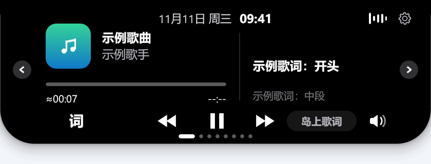
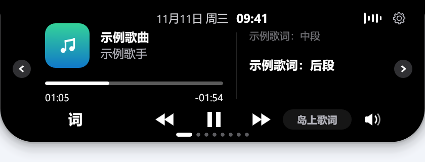

# SMTC 音乐兼容与歌词时间轴

非浏览器播放器即使声明 `PlaybackType=Music`，也可能因来源不在名单中而没有音乐卡片；部分播放器能提供曲目信息，却没有播放时间轴，导致已找到的歌词一直停在第零秒。本修复开放音乐会话识别，保留严格歌词匹配，并补充缺少时间轴时的计时与 Muyu 进度校准。

## 识别与显示

- 接受任意非浏览器来源的 Music 声明；保留浏览器专辑信息检查和明确视频标题排除。
- 未分类会话先进入严格查词，只有匹配到含正文的同步歌词才确认是音乐。纯文本、空歌词、无匹配和网络失败均不能确认。
- 播放中的未知候选不会被另一个暂停播放器挡住。岛体、音乐页、侧边停靠和宠物使用同一显示判定，确认前不开放控制。
- 确认结果绑定来源、歌名、歌手、曲长和已知歌曲 ID；刷新与暂停保留确认，切歌和切换来源重新确认。
- `src/lyrics.rs` 未修改，不引入“时长相近即可绕过歌手校验”的规则。

## 位置来源与边界

| 来源 | 连续播放 | 在播放器内拖动 |
| --- | --- | --- |
| 任意正确提供 SMTC 时间轴的音乐播放器 | 使用实际位置 | 跟随更新后的 SMTC 位置 |
| 已支持的 Muyu 原生版默认数据目录 | 使用保存的位置并在采样间外推 | 保存更新后重新校准，可能延迟数秒 |
| 没有 SMTC 时间轴且没有专用读取的播放器 | 从识别起本地计时，显示 `≈` | 无法知道实际跳转位置 |

本地计时在暂停时冻结、恢复后续走，来源或曲目身份变化时重置。真实时间轴始终优先，包括拖回第零秒；时间轴暂时消失时从最后位置继续。未知总时长继续显示 `--:--`，不根据歌词末尾编造曲长，也不将估算值送入严格查词。

本地计时参考 [NetSpeed-Dynamic](https://github.com/GEORGEWWWU/NetSpeed-Dynamic/blob/cea9ddd3d55de58ff9066527d0fbdbe196a2f2df/src/views/WidgetIsland.vue)。它不能恢复没有进度来源时的中途启动、拖动或同歌循环位置。未注册 SMTC 会话的软件和 JustSolo WebSocket 不在本修复范围内。

## Muyu 只读适配

Muyu 1.1.9 的 SMTC 位置、时长和更新时间为零，但原生播放器会保存当前播放位置。实现依据为其 [保存与跳转逻辑](https://github.com/kylin1104/muyuhuaweimusic/blob/bbf9ce96cbb377ee78f3b3e2c058b54f66374c2f/native_model.go)。

- 从运行中的 `Muyu.exe` 安装位置定位固定文件 `independent-data/native-ui.json`，只读取播放字段，不修改播放器文件。
- 仅支持已确认的格式版本，限制文件大小，验证当前歌曲的歌名、歌手、可用专辑和位置范围；其他队列项缺字段不影响当前歌曲。
- 播放中拒绝超过五秒的旧快照和未来时间戳。格式不符、身份不符或读取失败时回退到已有计时。
- 暂停时使用保存位置，恢复时不计入暂停时长；同大小、同修改时间的文件内容更新也能重新校准。
- 不读取账号文件，不将华为歌曲 ID 作为网易云 ID，不放宽歌词匹配。自定义 Muyu 数据目录不在自动发现范围。

## 验证

Windows x64、Rust 1.99.1，锁定依赖，使用隔离数据目录。生产源码与经过完整回归和 Release 构建的开发版本一致。

```powershell
$env:RUST_TEST_THREADS = '1'
cargo test --locked --all-targets --features record
cargo test --locked --lib --features record muyu_timeline
cargo build --release --locked --bin daozai
```

- 完整回归：**793 通过、0 失败、87 忽略**；Muyu 专项：**8 通过、1 忽略**。忽略项不计为通过。
- 显式只读实机测试在 Muyu 暂停和播放状态下均通过，确认能读取位置、时长和连续推进。
- 快进、后退、拖回开头、暂停续播及相同大小/时间戳覆盖由自动回归覆盖；实际拖动听感仍需人工验收。
- 标准 Release 构建通过；`src/lyrics.rs` 与上游基线一致。

## 合成界面示例

以下为实际 UI 代码通过软件光栅器渲染的示例，曲名、歌手和歌词均为合成内容，不包含用户截图或真实播放记录。

没有真实时间轴时，用 `≈` 表示本地估算，总时长保留为未知：



取得真实位置时使用实际进度，拖动后按新位置匹配歌词：



## 手动检查

先退出其他岛仔实例，再用独立数据目录启动新程序：

```powershell
$env:DAOZAI_DATA_DIR = Join-Path $env:TEMP 'daozai-open-media-check'
.\target\release\daozai.exe
```

检查播放、暂停恢复、切歌、切换来源，以及有真实位置来源时的前后拖动。对于只有本地估算的播放器，先启动岛仔，再从头播放新歌；不能用中途跳转判断其精确同步能力。浏览器中的明确 B站/YouTube 视频应继续排除，纯文本或查词失败不能确认未知会话。

读取原始 Windows 媒体会话：

```powershell
powershell.exe -NoProfile -ExecutionPolicy Bypass -File .\scripts\inspect-media.ps1 -Samples 3
```

诊断脚本不显示 Muyu 专用读取补充的位置，也不会修改或上传数据。输出含当前歌名与歌手，反馈问题时只需提供目标播放器相关记录。
